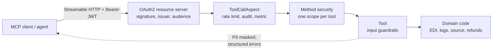

# Secure Spring Boot MCP Server

[](https://github.com/Adit12T/spring-boot-mcp-server/actions/workflows/ci.yml)

A reference **Model Context Protocol (MCP) Server** showing production security and resilience patterns, built with **Spring Boot 4.1**, **Spring AI**, **Spring Security OAuth 2.1**, **Redis Idempotency**, and **Resilience4j Bulkheads**.

> **Scope.** This is a demo. It contains no employer code or data. The order and refund domain is an in-memory stub, and the EDI files, logs and `sample-app` are synthetic.

## Architecture Overview

1. **Layer 1: Edge & Transport Boundary** — Streamable HTTP (`/mcp`) protected by `McpServerOAuth2Configurer` with RFC 9728 Protected Resource Metadata (`/.well-known/oauth-protected-resource`).
2. **Layer 2: Session & Protocol Engine** — Java 21 Virtual Threads (`spring.threads.virtual.enabled=true`) with `McpSyncServer`.
3. **Layer 3: Capability & Guardrail Layer** — Declarative `@McpTool` and `@McpResource` components with `@PreAuthorize` scope verification, semantic validation, and a Resilience4j bulkhead for concurrency limits.
4. **Layer 4: Domain & Infrastructure** — Clean domain services backed by Redis atomic idempotency locks (`SET NX EX`).

## How a tool call is handled



## Production controls

| Control | What it does | Where |
|---|---|---|
| Authentication | Every MCP request needs a signed JWT from the configured issuer | `McpSecurityConfig` |
| Audience validation | Tokens issued for another resource are rejected, as the MCP authorization spec requires | `McpSecurityConfig` (`mcp.security.validate-audience`) |
| Scoped access | Each tool needs its own scope; a logs token cannot issue refunds | `@PreAuthorize` on each tool |
| Tenant isolation | The tenant comes from the token, never from tool arguments | `CallerContext` |
| Audit logging | One JSON line per tool call: who, tenant, client, tool, outcome, duration, correlation id, and a hash of the arguments instead of their values. Denied and rate-limited calls are logged too | `ToolCallAspect`, `Slf4jAuditSink` |
| Rate limiting | Per tenant and per tool (default 60 calls a minute) | `ToolCallAspect`, `ResilienceConfig` |
| Metrics | `mcp.tool.calls` timer tagged by tool and outcome, exposed at `/actuator/prometheus` | `ToolCallAspect` |
| Input validation | Order ids, idempotency keys, line-of-business names and class names are checked before use | each tool |
| PII masking | Emails and long numbers in log text are masked before the text reaches the model | `PiiMasker` |
| Idempotency | A refund key is locked in Redis, marked completed on success, released on failure, and rejected if reused for a different refund | `ProductionPaymentMcpTools` |
| Concurrency limit | The refund tool has a bulkhead with a structured "busy" fallback | `ResilienceConfig`, `ProductionPaymentMcpTools` |
| Tool hints | Every tool declares `readOnlyHint`, `destructiveHint`, `idempotentHint` and `openWorldHint`, so clients can ask for confirmation before the refund tool | `@McpTool(annotations = ...)` |
| Structured errors | Tools return an error code, message and recovery hint, so the agent knows whether to retry | DTOs in `dto/` |

A sample audit line:

```json
{"event":"mcp_tool_call","correlationId":"6f0c...","tool":"compare_edi_environments","subject":"agent-1","tenantId":"tenant-1","clientId":"claude-agent","argumentsHash":"9b1d5c0e7a44f210","outcome":"SUCCESS","durationMs":12}
```

Outcomes are `SUCCESS`, `TOOL_ERROR` (handled error returned to the agent), `DENIED` (missing scope),
`RATE_LIMITED` and `EXCEPTION`.

## Tools

| Tool | Required scope | What it does |
|---|---|---|
| `get_order_status` | `orders:read` | Returns the status of an order for the authenticated tenant |
| `issue_customer_refund` | `payments:refund` | Issues a refund up to $500, with an idempotency key and a concurrency limit |
| `compare_edi_environments` | `edi:read` | Compares EDI files between two environments for a line of business and returns missing, extra, duplicate and changed members with likely causes |
| `analyze_error_logs` | `logs:read` | Groups errors from the logs and returns class and line, root cause, suggested fix, a regression test draft, and whether the error still occurs after the fix |
| `get_java_source` | `source:read` | Returns the lines around a line of an application class |

The three engineering tools are read-only and run on the sample data in `sample-data/` and `sample-app/`.
Their logic is the same code as my two agent demos, packaged under `com.example.mcp.agents`:
the EDI reconciliation agent and the Java debugging agent.

## Prompts

| Prompt | Argument | What it gives the agent |
|---|---|---|
| `investigate_production_errors` | `focus` (optional) | A workflow for diagnosing the errors in the logs with `analyze_error_logs` and `get_java_source`, grounded in tool output |
| `reconcile_edi_release` | `lineOfBusiness` | A release-readiness check built on `compare_edi_environments` |

### Guardrails on the engineering tools

- **One scope per tool.** A token that can read logs cannot issue refunds.
- **Inputs that reach the file system are validated.** `lineOfBusiness` must be a plain lower-case name, and
  `get_java_source` only accepts class names inside the configured application package, so neither tool can be
  steered to other files.
- **Errors are structured.** Each tool returns an error code, a message and a recovery hint instead of a stack trace,
  so the agent knows whether to retry.

## Quick Start

### Option A: everything in Docker (recommended)

Needs only Docker. One command builds the server and starts Redis and Keycloak, with the realm,
clients, scopes and audience mappers already loaded from `docker/keycloak/mcp-realm.json`.

```bash
docker compose up -d --build --wait
./docker/smoke-test.sh          # anonymous call rejected, scoped tool allowed, wrong scope denied
```

| Service | URL on this machine | Notes |
|---|---|---|
| MCP server | `http://localhost:8080/mcp` | Streamable HTTP; health at `/actuator/health` |
| Keycloak | `http://localhost:8081` | Admin console: `admin` / `admin` (local only) |
| Redis | `localhost:6379` | Idempotency locks for refunds |

Two demo clients show scoping:

| Client | Token scopes | Get a token |
|---|---|---|
| `mcp-engineering-agent` | `edi:read logs:read source:read` | `./docker/get-token.sh engineering` |
| `mcp-orders-agent` | `orders:read`, plus `payments:refund` only when asked for | `./docker/get-token.sh orders` or `./docker/get-token.sh orders payments:refund` |

Every token carries `tenant_id=tenant-demo` and the audience `http://localhost:8080/mcp`, so
audience validation stays on. Ports are published on `127.0.0.1` only, and the server runs as a
non-root user. The client secrets and admin password are public demo values: never reuse this
realm file outside your machine.

**MCP Inspector:** `npx @modelcontextprotocol/inspector`, transport `Streamable HTTP`,
URL `http://localhost:8080/mcp`, and paste `Bearer $(./docker/get-token.sh engineering)` as the
Authorization header. Tokens name the issuer `http://keycloak:8081/...` (the address the server
uses inside Docker). Fetching tokens with the script works as is; for a browser-based OAuth
flow, add `127.0.0.1 keycloak` to your hosts file.

`docker compose down` stops the stack; `-v` also removes volumes.

### Option B: server on your machine, Redis and Keycloak in Docker

```bash
docker compose up -d --wait redis keycloak
echo "127.0.0.1 keycloak" | sudo tee -a /etc/hosts      # once: the issuer is http://keycloak:8081
OAUTH2_ISSUER_URI=http://keycloak:8081/realms/mcp-realm mvn spring-boot:run
```

Then use `./docker/get-token.sh` as in option A. To use your own identity provider instead, point
`OAUTH2_ISSUER_URI` at it; it needs the scopes listed under Tools and an audience mapper that puts
`http://localhost:8080/mcp` in the token's `aud` claim (or start with `MCP_VALIDATE_AUDIENCE=false`
for a quick local experiment).

## Tests

```bash
mvn test
```

No Redis or Keycloak is needed to run the tests.

| Test class | What it proves |
|---|---|
| `McpServerSecurityIntegrationTests` | Starts the whole server against a stand-in identity provider and sends real signed tokens: anonymous calls get 401 with a pointer to the resource metadata, a token for another audience is rejected, a token for this server is accepted, and a tool is denied without its scope (and the denial is recorded) |
| `ToolCallAspectTests` | Audit events never contain argument values, outcomes are classified correctly, and the rate limit is per tool |
| `ProductionPaymentMcpToolsTests` | Refund input guardrails, the idempotency lock's life cycle, and rejection of a reused key |
| `EngineeringMcpToolsTests` | The three engineering tools on the sample data, including path guardrails |
| `PiiMaskerTests` | Emails and long numbers are masked; ordinary technical text is left alone |

## Threat model

| Risk | Mitigation here |
|---|---|
| Token issued for another service is replayed against this server | Audience validation on every request |
| Token passthrough to downstream systems | The server never forwards the caller's token; tools use only local data |
| Over-broad access by one agent | One scope per tool, checked on every call |
| Cross-tenant access through crafted arguments | Tenant taken from the token only |
| Prompt injection steering a tool to other files | Allow-list patterns on every argument that reaches the file system |
| Sensitive data leaking to the model through logs | PII masking of log text; arguments hashed in the audit trail |
| Duplicate money movement on retries | Redis idempotency lock with completed and released states |
| A runaway agent looping on a tool | Per-tenant, per-tool rate limit and a bulkhead on refunds |
| No record of what an agent did | Audit line for every call, including denied ones |

## Limitations

This is a demo, and these gaps are deliberate:

- The refund and order domain is an in-memory stub. No payment system is called.
- Rate limits are held in memory per server instance. A multi-instance deployment needs a shared store such as Redis.
- Audit events go to the application log. A real deployment would ship them to tamper-evident storage.
- The refund tool relies on the client honouring `destructiveHint` for confirmation. Server-side human approval
  (MCP elicitation) is not implemented.
- The Keycloak realm in `docker/` is for local use: fixed client secrets, `start-dev`, plain HTTP.
- Tool descriptions and prompts have not been scored against an evaluation set.

## Versions

Spring Boot 4.1.2, Spring AI 2.0.2 (MCP annotations now part of Spring AI), `mcp-server-security` 0.1.14, Resilience4j 2.4 core modules, Java 21.

## Configuration

| Property | Environment variable | Default | Meaning |
|---|---|---|---|
| `mcp.security.validate-audience` | `MCP_VALIDATE_AUDIENCE` | `true` | Reject tokens whose audience is not this server |
| `tool-resilience.calls-per-minute` | `MCP_TOOL_CALLS_PER_MINUTE` | `60` | Calls per tenant per tool per minute |
| `spring.security.oauth2.resourceserver.jwt.issuer-uri` | `OAUTH2_ISSUER_URI` | local Keycloak | Token issuer |

The engineering tools read their data locations from `application.yml` (`demo.edi.*`, `demo.logs.*`, `demo.source.*`).
Each can be overridden with an environment variable, for example `EDI_CANDIDATE_DIR`.

## License

Copyright © 2026 Aditya Tripathi. All rights reserved. The code is published for viewing only; see [LICENSE](LICENSE). Security reports: see [SECURITY.md](SECURITY.md).
